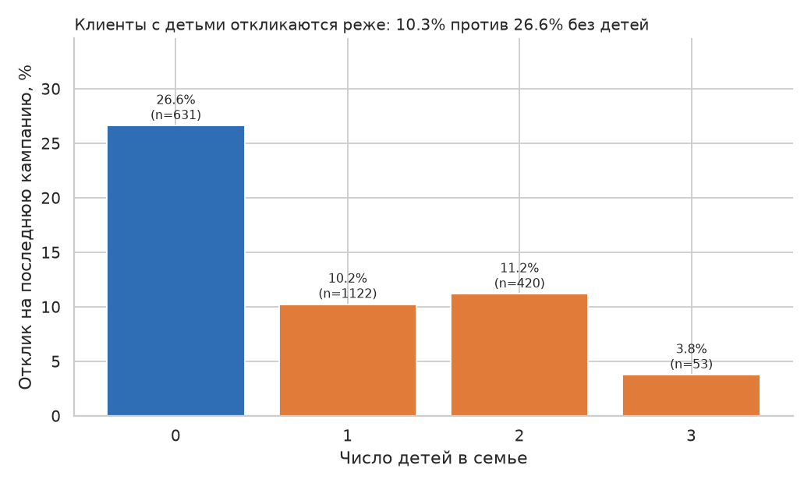
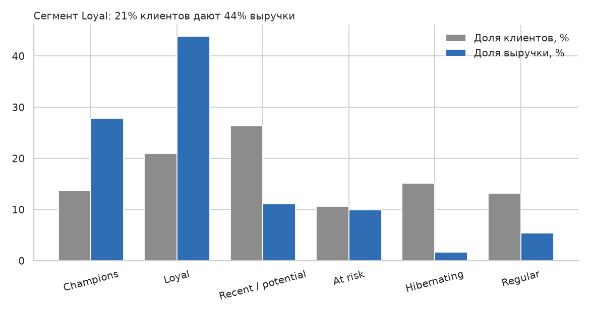
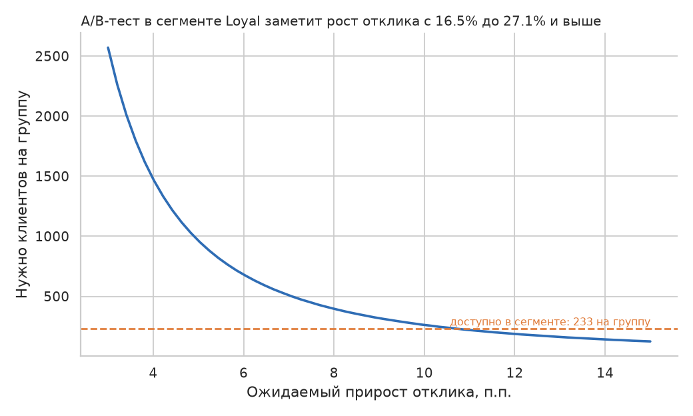
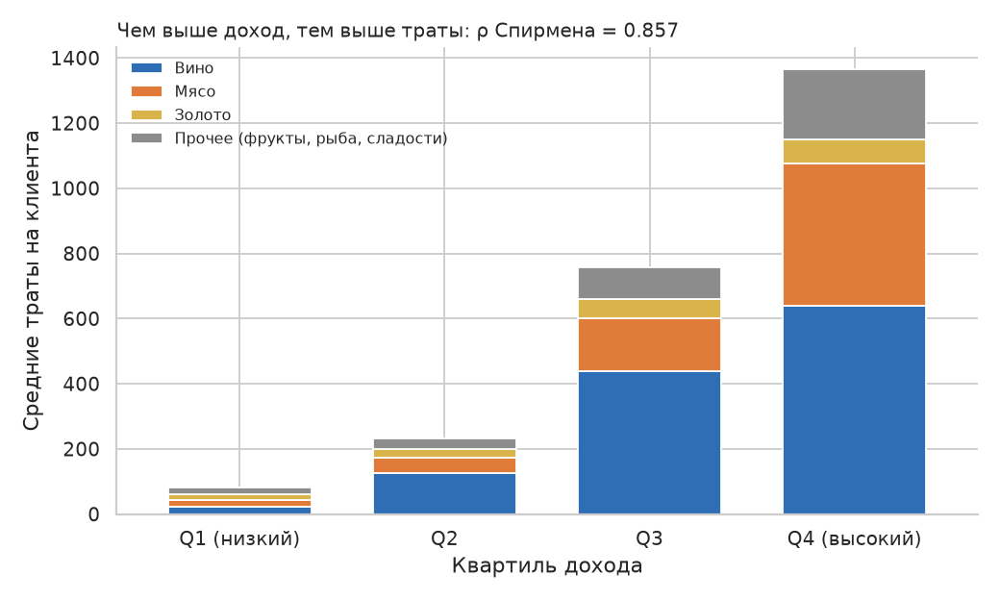
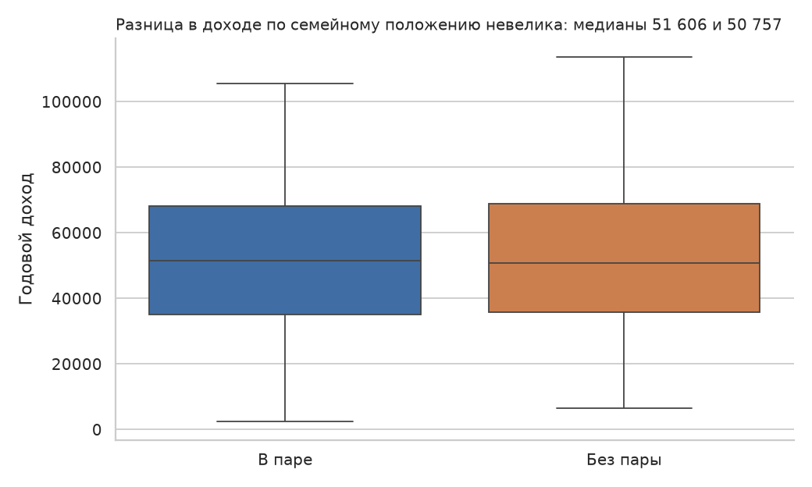
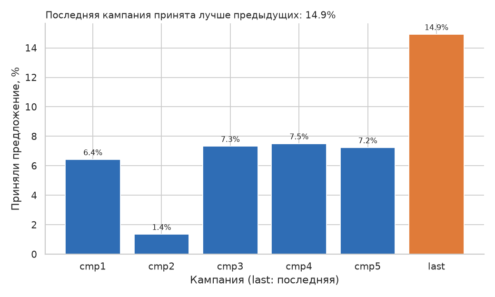

# Сегментация клиентов и эффективность маркетинговых кампаний

Данные: 2 240 клиентов розничной компании. После контроля качества в анализе 2 226 клиентов.

## 1. Контроль качества данных

Проверки выполняются в [sql/02_data_quality.sql](sql/02_data_quality.sql), результат хранится в таблице `dq.report` и на листе «Качество данных» в Excel.

| Проблема | Строк | Решение |
|---|---|---|
| Пропуски в `Income` | 24 | Оставлены без подстановки; исключаются только из расчётов с доходом |
| Выброс дохода (666 666, выше Q3 + 3·IQR) | 1 | Исключён |
| Год рождения до 1920 | 3 | Исключены |
| Невалидный `Marital_Status` (Absurd, YOLO) | 4 | Исключены |
| `Marital_Status = Alone` | 3 | Объединён со Single |
| Траты при нуле покупок | 6 | Исключены |
| Совпадение всех полей, кроме ID | 182 | Помечены флагом, оставлены; выводы проверены с ними и без них |
| Константные столбцы `Z_CostContact`, `Z_Revenue` | 2 | Не перенесены в `core` |

Исключено 14 клиентов.

## 2. Модель данных

- `core`: `customers`, `purchases_by_category`, `purchases_by_channel`, `campaign_responses`.
- `mart.customer`: одна строка на клиента (возраст, квартиль дохода, дети, траты, каналы, отклик).
- `mart.rfm`: оценки R, F, M через `NTILE(5)` и шесть сегментов.
- `mart.campaign_performance`: принятие каждой кампании.
- Аналитические запросы: [sql/05_analysis.sql](sql/05_analysis.sql).

## 3. Результаты

### Дети и отклик

Отклик на последнюю кампанию: 26,6 % у клиентов без детей и 10,3 % у клиентов с детьми. Разница −16,3 п.п., 95 % ДИ от −20,1 до −12,6 п.п. χ² = 93,9, p < 0,001, V Крамера = 0,21. Без подозрительных дублей результат сохраняется (27,7 % и 10,4 %).

### RFM-сегменты

| Сегмент | Клиентов | Средние траты | Доля выручки | Отклик |
|---|---|---|---|---|
| Champions | 304 | 1 239 | 27,9 % | 31,9 % |
| Loyal | 467 | 1 271 | 43,9 % | 16,5 % |
| Recent / potential | 586 | 256 | 11,1 % | 17,7 % |
| At risk | 237 | 569 | 10,0 % | 8,0 % |
| Hibernating | 338 | 69 | 1,7 % | 3,3 % |
| Regular | 294 | 249 | 5,4 % | 8,2 % |

Отклик зависит от сегмента: χ² = 129,5, p < 0,001, V = 0,24.

### Мощность A/B-теста для сегмента Loyal

Базовый отклик сегмента 16,5 %, в сегменте 467 клиентов, то есть около 233 на группу при делении поровну. Параметры: двусторонний тест двух долей, α = 0,05, мощность 80 %, размер эффекта по h Коэна.

| Ожидаемый прирост отклика | Нужно клиентов на группу | Мощность при 233 на группу |
|---|---|---|
| +3 п.п. | 2 570 | 13 % |
| +5 п.п. | 963 | 28 % |
| +7,5 п.п. | 447 | 53 % |
| +10 п.п. | 262 | 75 % |
| +15 п.п. | 125 | 97 % |

На 233 клиентах на группу тест с мощностью 80 % надёжно обнаружит рост отклика только до 27,1 % и выше (+10,6 п.п.). Более скромный эффект (+3-5 п.п.) потребует от 963 клиентов на группу, а такого сегмента в данных нет. Расчёт: функции `sample_size_per_group`, `power_two_proportions`, `min_detectable_rate` в [analysis.py](analysis.py). Результат перепроверен классической формулой для двух долей (262 и 264 клиента на группу при +10 п.п.) и симуляцией методом Монте-Карло (мощность 80 % при +10,6 п.п. и 72 % при +9,6 п.п.).

#### Длительность теста

Длительность зависит от того, сколько клиентов из сегмента попадает в тест за неделю. В данных этого нет, поэтому недели считаются как общий размер выборки (две группы), делённый на недельный поток клиентов. Поток задан сценариями.

| Прирост отклика | Всего клиентов | 25 в неделю | 50 в неделю | 100 в неделю | 200 в неделю |
|---|---|---|---|---|---|
| +3 п.п. | 5 140 | 206 нед. | 103 нед. | 52 нед. | 26 нед. |
| +5 п.п. | 1 926 | 78 нед. | 39 нед. | 20 нед. | 10 нед. |
| +7,5 п.п. | 894 | 36 нед. | 18 нед. | 9 нед. | 5 нед. |
| +10 п.п. | 524 | 21 нед. | 11 нед. | 6 нед. | 3 нед. |
| +15 п.п. | 250 | 10 нед. | 5 нед. | 3 нед. | 2 нед. |

Вывод: при делении 467 клиентов поровну тест надёжно обнаружит эффект только от +10,6 п.п. Чтобы ловить эффект +5 п.п., нужен тест на расширенной аудитории (около 1 900 клиентов) или более длительный по времени набор выборки.

### Доход и траты

ρ Спирмена = 0,857 (n = 2 202). Средние траты растут от 82 в нижнем квартиле дохода до 1 364 в верхнем. В нижнем квартиле заметно выше доля золота (20,6 % против 5,3 %).

### Семейное положение и доход

Медианный доход: 51 607 у клиентов в паре и 50 757 у клиентов без пары. Различие статистически незначимо (критерий Манна-Уитни, p = 0,66).

### Кампании

Последнюю кампанию приняли 14,9 % клиентов, предыдущие: от 1,4 % до 7,5 %.

## 4. Рекомендации

1. Приоритизировать в рассылках клиентов без детей: их отклик в 2,6 раза выше. Для семей с детьми нужен отдельный оффер.
2. Провести A/B-тест персонального предложения для сегмента Loyal: 467 клиентов приносят 44 % выручки, а отклик вдвое ниже, чем у Champions. Размера сегмента хватает только для эффекта от +10 п.п.; для меньшего эффекта нужно накапливать выборку за несколько кампаний.
3. Для сегмента At risk (237 клиентов, средние траты 569) запустить реактивацию недорогим каналом.
4. Не тратить бюджет на Hibernating: 15 % клиентов дают 1,7 % выручки.
5. Выяснить, чем последняя кампания отличалась от предыдущих, и масштабировать механику.

## 5. Ограничения

- Данные наблюдательные, причинность не доказана.
- Нет информации о том, какой оффер получал каждый клиент.
- Когорты по дате регистрации (`q5_signup_cohorts`) нельзя сравнивать напрямую: у новых клиентов было меньше времени на покупки.
- Границы RFM-сегментов условны: при равных значениях `NTILE` делит клиентов по `customer_id`.
- Выбросы определялись по правилу 3·IQR.
